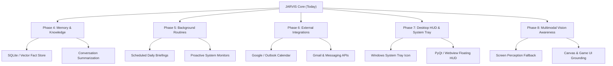

# JARVIS — Strategic Engineering Roadmap

This document outlines the planned future architecture and capabilities for JARVIS beyond the current core voice and desktop execution foundation.

---

## Phase 4: Long-Term Memory & Contextual Persistence

- **SQLite Vector / Relational Memory Store**:
  - Persistent storage for user preferences, custom application nicknames, frequently visited directories, and hardware quirks.
  - Semantic fact retrieval: query past user instructions and personal facts (e.g. `"Remember that my work projects are in C:\Workspace\Projects"`).
- **Session Summarization**:
  - Compact multi-day conversation memory, distilling key takeaways into a persistent profile while preserving context window efficiency.

---

## Phase 5: Routines & Autonomous Background Scheduling

- **Scheduled Routines**:
  - Configurable cron-style and time-based routines (e.g. Morning Briefing at 8:00 AM covering weather, calendar events, and system status).
  - Periodic system maintenance (checking battery health, disk space thresholds, unread notifications).
- **Event-Driven Triggers**:
  - Trigger actions on system events: high CPU/RAM usage alerts, power state transitions (AC to battery), or network reconnects.

---

## Phase 6: Ecosystem Integrations

- **Calendar & Productivity**:
  - Bi-directional sync with Google Calendar and Microsoft Outlook for agenda review and meeting scheduling.
- **Email & Communications**:
  - Local or OAuth-based access to read summaries of urgent emails or draft quick replies via voice commands.
- **Media & Streaming APIs**:
  - Direct Spotify Web API integration for seamless playlist curation and playback controls alongside local media key emulation.

---

## Phase 7: Desktop HUD & System Tray Experience

- **Windows System Tray Resident (`pystray`)**:
  - Minimal background daemon running in the Windows Notification Area.
  - Right-click tray menu for quick model switching, diagnostic logs, mic tests, and graceful shutdown.
- **Floating Heads-Up Display (HUD)**:
  - Lightweight, semi-transparent desktop overlay widget (PyQt6 or webview).
  - Visual indicators for assistant states: `IDLE`, `LISTENING` (audio waveform), `THINKING` (pulse), `SPEAKING` (subtitles/transcription display).

---

## Phase 8: Multimodal Screen Perception & Vision Grounding

- **Vision Fallback Engine**:
  - For applications that render custom UI without Windows UI Automation trees (e.g. Flutter apps, electron canvas apps, legacy win32 utilities, games).
  - Capture active window screenshots in-memory (strictly never saving to disk and never capturing protected/credential screens).
  - Ground clicks and inputs via visual bounding box coordinates using multimodal models (Gemini Flash Vision or local vision backends).
